# MeshCore Remote

Web-Oberfläche zur Fernsteuerung eines MeshCore-LoRa-Nodes, mit Automatisierung
(Repeater-Akku überwachen, automatische Pings, Auto-Antworten). Backend und Oberfläche
laufen direkt auf dem Raspberry Pi, an dem der Node hängt. Status und Nachrichten kommen live per WebSocket.

> **Inoffiziell:** Dieses Projekt ist ein privates Hobbyprojekt und **nicht** mit MeshCore verbunden, nicht von MeshCore geprüft und nicht offiziell.
> „MeshCore“ ist der Name des Funk-Netzwerks/der Firmware, mit der dieses Programm spricht.
>
> **KI-generiert, keine Verantwortung:** Dieses gesamte Projekt (Code, Tests und Dokumentation) wurde mit Hilfe von künstlicher Intelligenz
> (Claude von Anthropic) erstellt. Der Code wurde vom Veröffentlichenden **nicht überprüft**, und er **übernimmt keine Verantwortung und keine Haftung**
> für Fehler, Schäden, Datenverlust, Funkstörungen oder Verstöße gegen Funk- und Datenschutzvorschriften. Nutzung ausschließlich auf eigenes Risiko.
> Wer das Programm betreibt, ist selbst dafür verantwortlich, dass es mit den örtlichen Funkregeln (z. B. Sendezeit im 868-MHz-Band) vereinbar ist.
>
> **Stand:** Alles wurde im Simulator getestet. Mit echter Hardware (Raspberry Pi 3 B + Heltec V4) läuft vieles, aber nicht alles ist geprüft; bei den
> einzelnen Funktionen steht, was noch nicht an echter Hardware getestet ist. Das Programm sendet über Funk: Bitte die Schutzregeln der Automatik (Abschnitt
> „Automatik und Funkmedium“) nicht umgehen. Nutzung auf eigene Verantwortung, ohne Gewähr.
>
> **Lizenz:** MIT mit „Commons Clause“, siehe [LICENSE](LICENSE). Kurz: Nutzen, ändern und kostenlos weitergeben ist erlaubt, **verkaufen** (auch als
> bezahlter Dienst oder bezahlter Support) nicht. Das ist keine Open-Source-Lizenz im Sinne der OSI.

**Installation auf dem Raspberry Pi:** [docs/raspberry-pi.md](docs/raspberry-pi.md) (Schritt für Schritt, mit Autostart und Watchdog).
Das Programm braucht außerdem den passenden **Watchdog** (eigenes Repo: [meshcore-watchdog-pi](https://github.com/BlackSky2035/meshcore-watchdog-pi), übernimmt Updates und Überwachung).

## So sieht es aus

Alle Bilder sind Aufnahmen des **Simulators** (erfundene Namen, keine echten Daten), hier in der Handy-Ansicht.

<table>
<tr>
<td>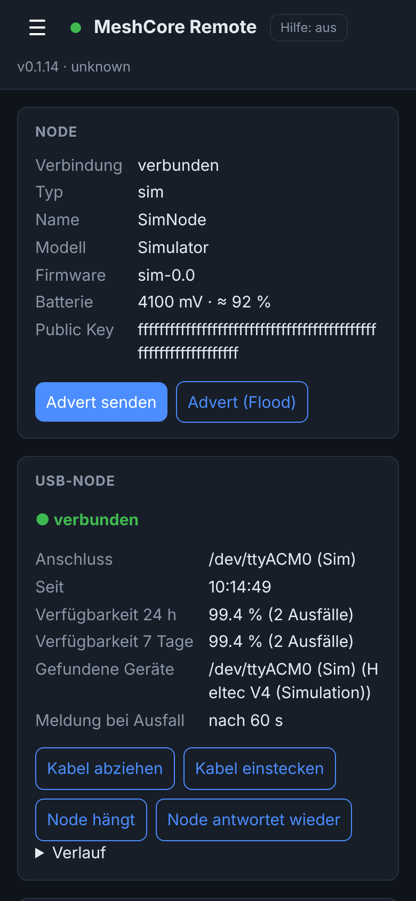<br><sub>Übersicht</sub></td>
<td>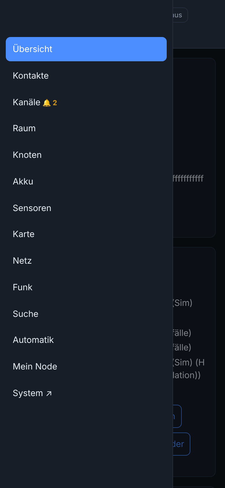<br><sub>Menü am Handy</sub></td>
<td>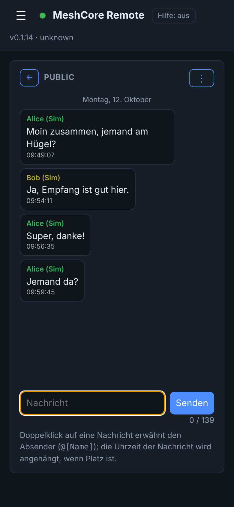<br><sub>Kanäle</sub></td>
<td>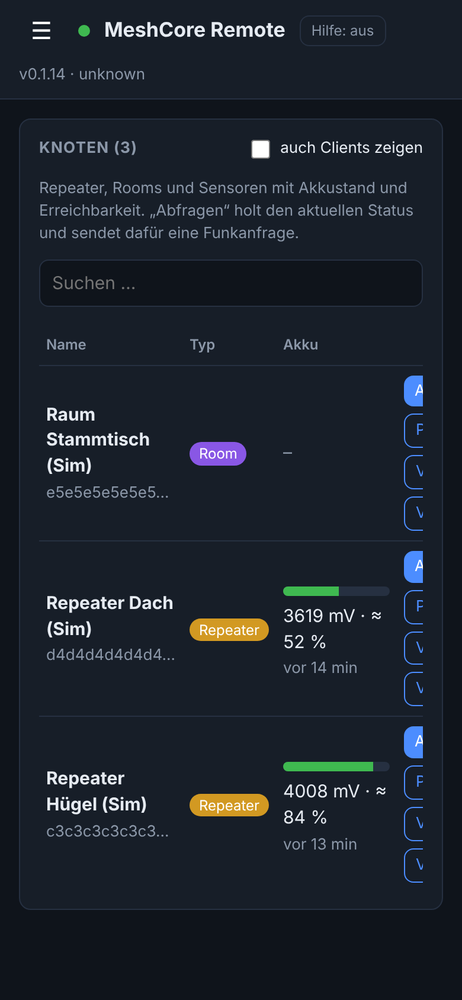<br><sub>Knoten</sub></td>
</tr>
<tr>
<td>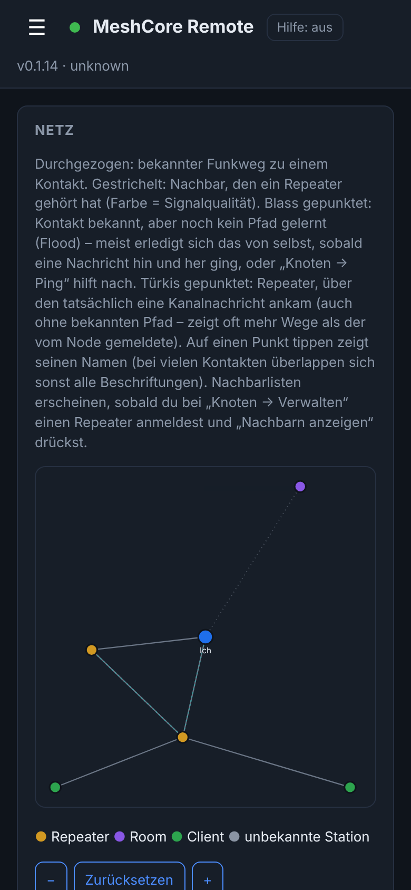<br><sub>Netz</sub></td>
<td>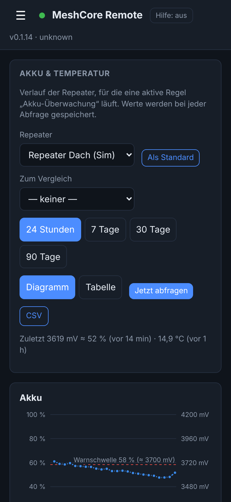<br><sub>Akku und Temperatur</sub></td>
<td>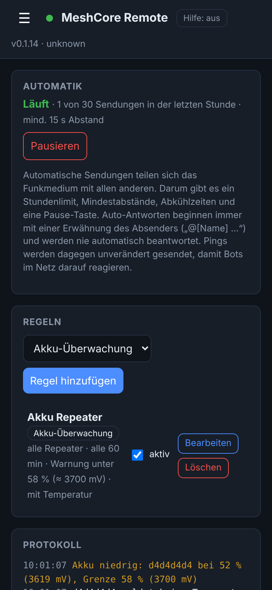<br><sub>Automatik</sub></td>
<td>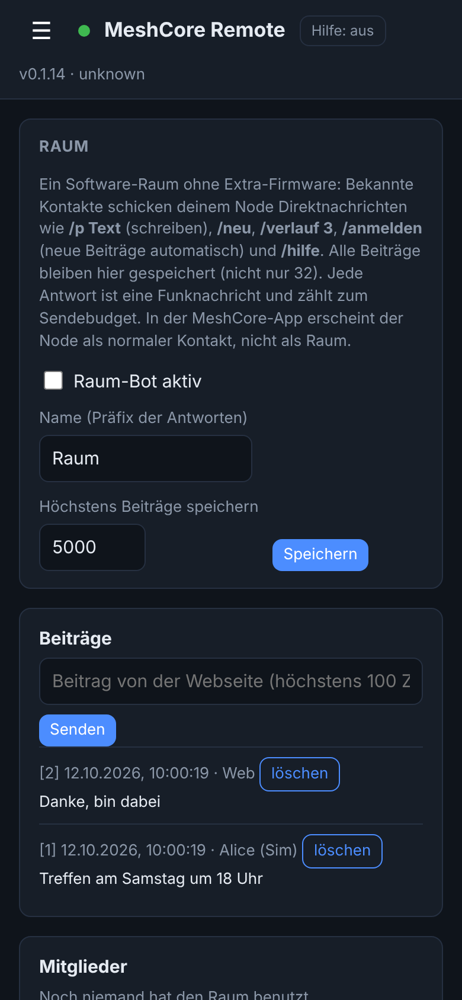<br><sub>Raum</sub></td>
</tr>
</table>

**Repeater verwalten** (Knoten → „Verwalten“) und **Mein Node** (Einstellungen des eigenen Nodes):

<table>
<tr>
<td>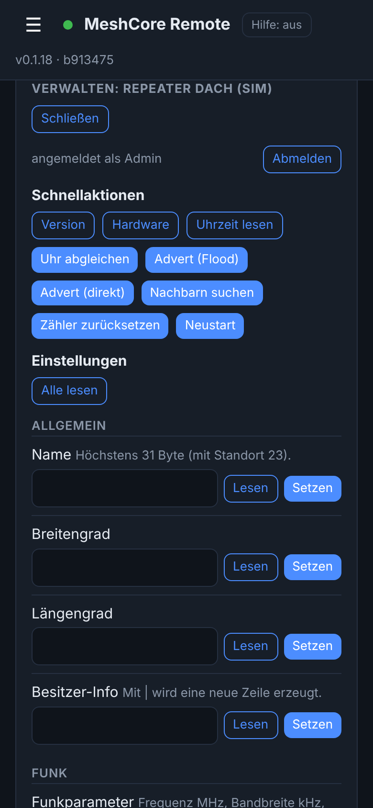<br><sub>Repeater: Schnellaktionen</sub></td>
<td>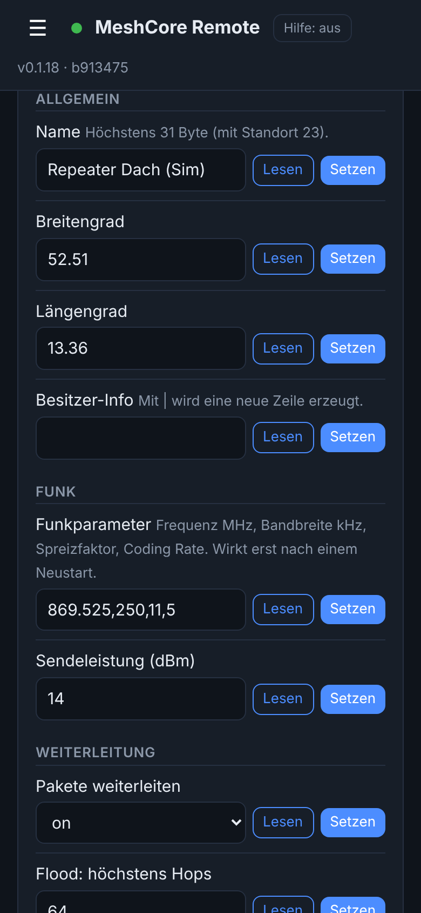<br><sub>Repeater: Einstellungen lesen und setzen</sub></td>
<td>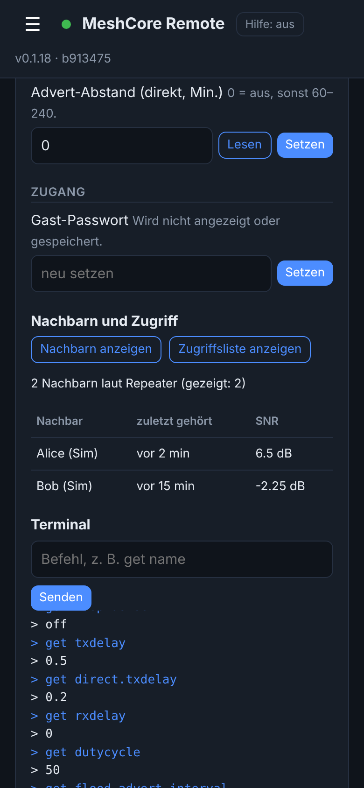<br><sub>Repeater: Nachbarn und Terminal</sub></td>
<td>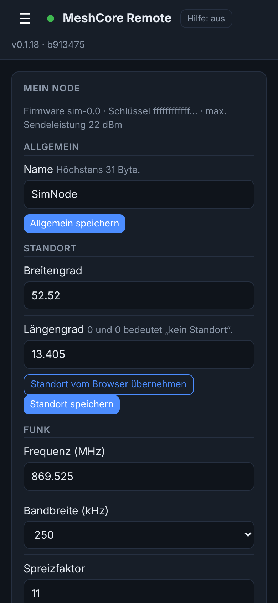<br><sub>Mein Node</sub></td>
</tr>
</table>

Der **Watchdog** (Updates, Überwachung, Steuerung) hat eine eigene Oberfläche, Bilder dazu stehen in seinem [Repo](https://github.com/BlackSky2035/meshcore-watchdog-pi).


## Funktionen

| Seite | Inhalt |
|-------|--------|
| Übersicht | Node-Status, Advert senden, Live-Log |
| Kanäle | Kanäle anlegen (privat mit Schlüssel, `#hashtag`), bearbeiten, löschen – wird auf den Node geschrieben; Chat mit Verlauf je Kanal; Doppelklick auf eine Nachricht erwähnt den Absender (`@[Name]`, eckige Klammern im Namen werden entfernt) und hängt beim Senden die Uhrzeit an, zu der diese Nachricht empfangen wurde (`@[Name] (14:32) Text`) – nur wenn die Nachricht dadurch nicht über 139 Zeichen wächst, sonst entfällt die Uhrzeit (der Zähler zeigt es an); pro Kanal schaltbar: Pfade eingehender Nachrichten und gehörte Repeats eigener Nachrichten (gespeichert wird immer) |
| Kontakte | suchen und filtern, per Kontaktkarte hinzufügen, löschen, Pfad zurücksetzen, Karte teilen, Chat mit Verlauf |
| Knoten | Repeater/Rooms/Sensoren mit Akkustand, Erreichbarkeit, Verlauf, „Abfragen“ und Ping; nach jedem Ping/Abfragen steht über der Tabelle die Rückmeldung (wartet … → ✓ Antwort erhalten mit Laufzeit/SNR/Akku oder ✗ keine Antwort/Fehler), auch auf dem Handy |
| Karte | alle Kontakte mit Position (Leaflet, lokal ausgeliefert) |
| Sensoren | Telemetrie-Werte (z. B. Temperatur) im Verlauf, **nicht an echter Hardware getestet** |
| Akku | Akku- und Temperaturverlauf je überwachtem Repeater, Diagramm und Tabelle, CSV; beide Diagramme haben dieselbe Zeitachse (untereinander deckungsgleich), so lassen sich Akku und Temperatur direkt vergleichen |
| Automatik | Regeln für Akku-Überwachung, Pings, Auto-Antworten und automatische Adverts, Pause-Schalter, Sendebudget, Protokoll |
| Raum | Software-Raum per Direktnachricht (Beiträge, Mitglieder), Webseite zum Mitschreiben; **nicht mit echten Teilnehmern getestet** |
| Netz | Funkwege und von Repeatern gemeldete Nachbarn als Grafik; **nicht an echter Hardware getestet** |
| Funk | Zähler und Rauschpegel des eigenen Nodes im Verlauf; **nicht an echter Hardware getestet** |
| Suche | alle Nachrichten durchsuchen, Stichwörter mit Push-Meldung |
| Mein Node | Einstellungen des eigenen Nodes, Sicherung/Wiederherstellung; Standardfunktionen am echten Node getestet, nicht jedes Detail |
| System ↗ | Link zum Watchdog (Updates, Überwachung, Steuerung) |

## Schnellstart zum Ausprobieren (Simulator)

Entwickelt und im Betrieb getestet ist das Programm **nur auf dem Raspberry Pi** (Raspberry Pi OS). Andere Systeme (macOS, Windows, andere Linux-Distributionen) sind **nicht getestet**.
Der Simulator braucht keine Hardware:

```bash
python3 -m venv venv
source venv/bin/activate
pip install -r requirements.txt

cp config.example.toml config.toml   # dann Modus anpassen
python -m app.main
```

Dann im Browser `http://127.0.0.1:8000` öffnen. Ohne Anpassung läuft der **Simulator**
(mit Beispielkontakten, zwei Repeatern und gelegentlichen Nachrichten), so lässt sich
alles ohne Hardware ausprobieren.

### Modi (`config.toml` → `[node] mode`)

| Modus | Bedeutung |
|-------|-----------|
| `sim` | Simulator ohne Hardware (Standard) |
| `serial` | Node per USB. `serial_port = "auto"` sucht selbst, sonst festen Pfad angeben |

**Getestet ist nur `serial` (USB) am Raspberry Pi.** Im Code gibt es außerdem die Modi `tcp` (WLAN) und `ble` (Bluetooth). Sie sind **nicht getestet** und werden hier weder dokumentiert noch unterstützt.

Alles lässt sich auch per Umgebungsvariable setzen (`MC_<FELDNAME>`), z. B.
`MC_MODE=serial MC_SERIAL_PORT=/dev/ttyACM0 MC_DEBUG=1 python -m app.main`.
Mit `MC_DEBUG=1` zeigt die Bibliothek, was der Node schickt – hilfreich beim ersten Test
mit echter Hardware.

Oben rechts schaltet **Hilfe: aus/an** Tooltips ein (Erklärung beim Darüberfahren, Texte in `static/lib/tips.js`). Der Link „System“ öffnet den Watchdog; zum Ausprobieren im Simulator vorher im Watchdog-Ordner `python -m watchdog --demo` starten.

## Automatik und Funkmedium

LoRa ist ein geteiltes Medium mit begrenzter Sendezeit. Die Automatik schützt es deshalb:

- **Sendebudget** für alle automatischen Sendungen zusammen: Mindestabstand 15 s, höchstens
  30 pro Stunde (`[automation]` in der Konfiguration).
- **Mindestintervall** 5 Minuten für Pings und Akku-Abfragen, 15 Minuten für den Kanal-Ping
  (er erreicht alle im Kanal).
- **Pings** gehen bewusst **ohne** `[auto]` raus, weil andere Bots nur auf das nackte Wort „ping“
  antworten. Arten: *Direkt-Ping (Zero-Hop)* für Repeater/Rooms in direkter Funkreichweite
  (Trace-Paket, zeigt die Signalstärke SNR hin und zurück), *Statusabfrage* (auch über mehrere Hops)
  und *Nachricht* (für Clients). Der *Kanal-Ping* postet einen Text regelmäßig in einen Kanal.
- **Auto-Antworten** beginnen mit einer Erwähnung des Absenders (`@[Name] …`) und werden nie auf Nachrichten beantwortet, die selbst mit einer Erwähnung beginnen,
  damit sich zwei Auto-Antworter nicht endlos hin und her schreiben. Dazu gibt es eine
  Abkühlzeit je Absender.
- **Pause-Schalter** in der Oberfläche, bleibt über Neustarts erhalten.

Regeln:
- *Akku-Überwachung*: fragt Repeater regelmäßig ab, speichert den Akkustand und warnt
  einmal, wenn er unter die Schwelle fällt. Optional wird zusätzlich die Temperatur per Telemetrie
  abgefragt (eine weitere Funkanfrage; Repeater ohne Sensor werden 24 h lang nicht mehr gefragt).
  Die Warnstufe stellst du je Regel in **Prozent** ein (Standard 58 % ≙ 3700 mV; gespeichert wird in mV, daneben steht der mV-Wert). Die Skala ist linear wie in der MeshCore-App (3000 mV = 0 %, 4200 mV = 100 %) und überall gleich: Regel, Seite, Protokoll und Push-Meldung nutzen `app/battery.py` bzw. `batteryPct` in `static/lib/util.js`. Die Seite **Akku** zeigt Verlauf (mV mit zusätzlicher Prozent-Skala rechts; lineare Näherung, keine echte Ladestandsmessung) als Diagramm und Tabelle (24 h bis 90 Tage, CSV-Export) für alle
  Repeater, für die eine aktive Akku-Regel läuft.
- *Automatischer Ping*: Statusabfrage (unsichtbar, für Repeater/Rooms) oder Nachricht
  (für Clients, wartet auf die Empfangsbestätigung).
- *Auto-Antwort*: antwortet auf Direktnachrichten mit bestimmtem Text. Platzhalter in der
  Antwort: `{name}`, `{time}`, `{hops}`, `{path}` (Weg der empfangenen Nachricht: Kurzkennungen der Repeater, z. B. `a1,b2,c3`; `direkt` ohne Zwischenstation; bei Direktnachrichten oft nur die Hop-Zahl, wenn der Node den Weg nicht mitliefert). **Die Antwort beginnt automatisch mit einer Erwähnung des Absenders (`@[Name] …`); `{name}` am Anfang des Textes würde den Namen doppelt zeigen und ist daher meist überflüssig.** Funktioniert auch in Kanälen (Auswahl im Formular). Begrenzungen:
  *Pause je Person* (z. B. nur alle 30 min dieselbe Person; im Kanal zählt der Absendername) und
  *höchstens N Antworten pro 60 min* je Regel (Standard 10, gilt auch für ältere Regeln).

Die Automatik läuft im Backend und arbeitet auch, wenn kein Browser offen ist.

## Betrieb auf dem Raspberry Pi

Worauf es auf dem Pi ankommt:

- **Serieller Port:** `/dev/ttyACM0` oder `/dev/ttyUSB0` (`serial_port = "auto"` sucht selbst).
  Der Benutzer muss in der Gruppe `dialout` sein:
  `sudo usermod -aG dialout $USER` (danach neu anmelden).
- **Repeater verwalten:** Knoten-Seite → „Verwalten“ bei einem Repeater/Room. Anmelden mit dem Admin-Passwort, dann Schnellaktionen
  (Version, Uhrzeit, Advert, Neustart …), Einstellungen lesen und setzen (Name, Standort, Funkparameter, Sendeleistung, Weiterleitung,
  Advert-Abstände, Gast-Passwort …), Nachbarn, Zugriffsliste und ein Terminal für eigene Befehle der MeshCore-Repeater-CLI.
  **„Nachbarn suchen“** (bei den Schnellaktionen) schickt dem Repeater den Befehl `discover.neighbors`; seine Antwort steht im Terminal. **„Nachbarn anzeigen“** (weiter unten) fragt dagegen die Nachbarliste ab,
  die der Repeater schon kennt, und zeigt sie als Tabelle (Name, zuletzt gehört, SNR; höchstens 15 Einträge). Was der Repeater auf „Nachbarn suchen“ antwortet, hängt von seiner Firmware ab.
  Riskante Befehle (Neustart, Funkparameter, Passwort …) fragen vorher nach; Werkseinstellung und Identitätsschlüssel sind gesperrt.
  Jeder Schritt geht per Funk und kann dauern. Das Passwort wird nur auf Wunsch gemerkt (eigene Datei, nicht in der Datenbank).
  Die Standardfunktionen sind an einem echten Repeater getestet und gehen; nicht jedes Detail wurde geprüft (z. B. nicht jede Einstellung, Nachbarn- und Zugriffslisten-Abfrage).
- **USB-Überwachung:** Das Programm erkennt den Node selbst (auch nach dem Umstecken, auch wenn der Gerätename wechselt),
  prüft alle 30 s, ob er wirklich antwortet, und verbindet sich nach Ausfällen von allein wieder. Die Übersicht zeigt Zustand,
  Verfügbarkeit (24 h/7 Tage) und Verlauf; nach 60 s Ausfall gibt es ein Banner, einen Protokolleintrag und (wenn „Warnungen“ im
  Push aktiv ist) eine Push-Meldung, ebenso bei Rückkehr. Im Simulator kannst du das Abziehen mit Knöpfen durchspielen.
  Bei mehreren USB-Geräten am Pi `serial_port` fest auf `/dev/serial/by-id/…` setzen. Die Karte „USB-Node“ auf der Übersicht funktioniert am echten Pi; das Abziehen und Wiederverbinden sowie die Meldungen wurden nicht einzeln geprüft.
- **Erreichbarkeit (abgesichert):** Auch auf dem Pi bei `host = "127.0.0.1"` bleiben. Dann
  kommt niemand im WLAN/LAN direkt an die Seite. Erreichbar wird sie über einen SSH-Tunnel oder über Tailscale
  (HTTPS mit `tailscale serve`, siehe Abschnitt „Zugriff über Tailscale“ und die Checkliste unter „Sicherheit“).
- **SD-Karte:** Markenkarte (am besten „High Endurance“) verwenden. Die Datenbank schreibt
  nur wenig, alte Einträge werden nach `retention_days` gelöscht.
- **Autostart:** auf dem Pi per systemd, Dienst-Dateien im Watchdog-Repo (`deploy/`), Anleitung in [docs/raspberry-pi.md](docs/raspberry-pi.md).
- **Verbindung zum Node:** getestet ist nur USB (seriell). Bluetooth und WLAN/TCP sind nicht getestet.

Nach der Einrichtung prüfen: Server starten, Node wird verbunden, Seite aufrufen,
Advert senden, Kontakte laden, Nachricht senden, einen Repeater abfragen.

## Karte ohne Internet

Die Kartenbibliothek (Leaflet) wird vom Server selbst ausgeliefert, die Kartenkacheln
(OpenStreetMap) kommen aber aus dem Internet. Ohne Internet bleiben die Marker sichtbar, der
Kartenhintergrund fehlt. Mit `tile_url` unter `[map]` lässt sich später ein lokaler
Kachelserver eintragen.

## API

Die Tabelle ist ein **Auszug** der wichtigsten Pfade. Neuere Bereiche (Raum `/api/room/*`, Netz `/api/network`, Sensoren `/api/sensors/*`, Funk `/api/stats`, Suche `/api/search`,
Mein Node `/api/node/*`, Sicherung `/api/backup/*`, Repeater-Verwaltung `/api/repeater/*`, Wartung `/api/maintenance`, Push `/api/push/*`, Stationen `/api/peers`) stehen nicht darin;
maßgeblich ist `app/api.py`. Mit gesetztem `access_password` braucht jeder Pfad unter `/api` und `/ws` eine Anmeldung, außer `/api/health` und `/api/version`.

| Methode | Pfad | Zweck |
|---------|------|-------|
| GET | `/api/status`, `/api/version`, `/api/config` | Status, Version, Karteneinstellungen |
| GET | `/api/contacts` | Kontaktliste (Typ, Position, Pfad, zuletzt gesehen) |
| POST | `/api/contacts/import` | `{"card": "meshcore://…"}` Kontakt hinzufügen |
| DELETE | `/api/contacts/{key}` | Kontakt löschen |
| POST | `/api/contacts/{key}/reset-path` | Pfad zurücksetzen |
| GET | `/api/contacts/{key}/export`, `/api/contacts/export` | Kontaktkarte (Kontakt bzw. eigener Node) |
| POST | `/api/message` | `{"to": "<public key hex>", "text": "..."}` |
| POST | `/api/channel` | `{"channel": 0, "text": "..."}` |
| GET/POST | `/api/channels` | Kanäle auflisten / anlegen (`name`, optional `idx`, `secret`) |
| PUT/DELETE | `/api/channels/{idx}` | Kanal ändern / löschen (schreibt auf den Node) |
| GET | `/api/channels/{idx}/secret`, `/messages` | Kanalschlüssel, Chatverlauf (mit Pfad, SNR/RSSI, Repeats) |
| PUT | `/api/channels/{idx}/view` | `{"show_details": true}` Pfade/Repeats im Chat einblenden |
| GET | `/api/messages?peer=<hex-präfix>` | Nachrichtenverlauf |
| POST | `/api/advert` | `{"flood": false}` |
| GET | `/api/nodes` | Kontakte mit letztem Akkustand und letzter Erreichbarkeitsprüfung |
| POST | `/api/nodes/{key}/poll` | Repeater-Status jetzt abfragen (speichert Akku) |
| POST | `/api/nodes/{key}/ping` | `{"mode": "status" \| "message"}` |
| GET | `/api/nodes/{key}/history?hours=168` | Akku-, Temperatur- und Ping-Verlauf |
| GET | `/api/battery/nodes` | überwachte Repeater (aktive Akku-Regeln) mit letzten Werten |
| GET | `/api/battery/{key}?hours=168` | Akku und Temperatur zusammengeführt (`ts, mv, temp`) |
| GET | `/api/battery/{key}/export.csv` | dasselbe als CSV (Semikolon, UTC) |
| GET/POST/PUT/DELETE | `/api/rules` | Automatik-Regeln |
| GET | `/api/automation` | Pausenstatus, Sendebudget, Protokoll |
| POST | `/api/automation/pause` | `{"paused": true}` |
| WS | `/ws` | Live-Events (Nachrichten, Adverts, ACKs, Automatik, Akkuwarnungen) |

## Tests

```bash
pip install -r requirements-dev.txt
pytest
```

Die Backend-Tests laufen im Simulator, ohne Hardware. Zusätzlich gibt es einen UI-Rauchtest
(`tests/ui_smoke/`, braucht Node.js nur zum Testen). Der echte Node-Pfad (`app/node/real.py`)
lässt sich nur mit angeschlossener Hardware prüfen.

## Startbildschirm und Push-Benachrichtigungen

*Getestet mit iPhone, Mac und Windows-PC. Android und andere Browser sind nicht geprüft.*

- **Zum Startbildschirm hinzufügen** (installierbare Web-App mit eigenem Icon, ohne Browserleiste): Android/Chrome: Menü →
  „App installieren“; iPhone/iPad: Safari → Teilen → „Zum Home-Bildschirm“.
- **Push je Kanal:** Seite „Kanäle“ → Kasten „Benachrichtigungen“ → „Auf diesem Gerät aktivieren“, danach im Chat des Kanals
  die Art wählen: *aus*, *jede Nachricht* oder *einmal, bis gelesen*. Optional auch bei Akku-Warnungen. „Test“ schickt eine Probe-Meldung. Jedes Gerät hat eigene Einstellungen.
- **Ungelesen:** In der Kopfzeile steht bei „Kanäle“ eine Glocke mit der Zahl aller ungelesenen Nachrichten (auch im Tab-Titel und, wo
  unterstützt, am App-Symbol); in der Kanalliste zeigt jeder Kanal seine eigene Zahl. Ein Kanal gilt als gelesen, sobald du ihn auf der
  Webseite geöffnet hast (oder eine Nachricht eintrifft, während er offen und sichtbar ist). Der Stand liegt auf dem Server und gilt für
  alle deine Geräte; bereits vorhandener Verlauf zählt nicht als ungelesen.
- **„Einmal, bis gelesen“:** Es kommt nur bei der ersten neuen Nachricht eine Meldung. Danach schweigt der Kanal, egal wie viele folgen,
  bis du ihn auf der Webseite angesehen hast; die nächste neue Nachricht meldet sich dann wieder. (Waren beim Einschalten schon
  ungelesene Nachrichten da, kommt erst nach dem nächsten „gelesen“ wieder eine Meldung.) „Jede Nachricht“ meldet alles.
- **Voraussetzungen:**
  - **https** (Browser-Regel): über Tailscale (`tailscale serve`, siehe unten) oder `localhost`. Über `http://<IP>` im Heimnetz geht es nicht.
  - **iPhone/iPad:** Push nur für die App auf dem Home-Bildschirm (iOS 16.4 oder neuer), nicht in einem normalen Safari-Tab.
  - **Internet auf dem Pi** zum Zeitpunkt der Meldung: Die Nachricht läuft über die Push-Dienste von Apple/Google/Mozilla. Der Inhalt ist
    für das Gerät Ende-zu-Ende verschlüsselt (RFC 8291), die Dienste sehen nur, dass etwas ankommt. Ohne Internet gibt es im
    reinen Heimnetz keine Push-Meldungen (die Seite selbst funktioniert weiter).
- **Technik:** Eigene Web-Push-Umsetzung (`app/webpush.py`, gegen den Testvektor aus RFC 8291 geprüft) mit `cryptography`;
  VAPID-Schlüssel entstehen beim ersten Aufruf und liegen in der Datenbank (nicht weitergeben, nicht in Git). Höchstens 120
  Meldungen pro Stunde und Gerät; abgemeldete Geräte werden automatisch entfernt. Sende-Fehler stören den Betrieb nicht.
  Kontaktadresse für VAPID: `push_contact` ist fest `mailto:meshcore-remote@example.com` (Pflichtangabe, wird nicht zugestellt).

## Ausfallsicherheit
Einzelne Fehler sollen nie das ganze Programm beenden; stattdessen gibt es eine Meldung:
- Jede Anfrage ist abgesichert: unerwartete Fehler ergeben `500` mit Text, Datenbankfehler `503`, die Seite lädt weiter.
- Lässt sich die Datenbank nicht öffnen (kaputt, gesperrt, Platte voll), startet das Programm trotzdem mit einer Datenbank im
  Arbeitsspeicher und zeigt oben einen Hinweis (Daten gehen dann beim Neustart verloren).
- Startet die Automatik nicht, läuft die Oberfläche trotzdem; der Grund steht als Hinweis dort.
- Fehler in Event-Listenern, in einzelnen Regeln und im Zeitplan werden protokolliert und stoppen nichts. Ein hängender Browser
  (WebSocket) blockiert nach 5 s niemanden mehr. Bei Verbindungsverlust versucht der Supervisor die Verbindung mit wachsendem Abstand (3 s bis 30 s) neu aufzubauen.
- Der Node-Status darf ausfallen, ohne dass die Seite leer bleibt (`node_error`). `/api/health` kostet nichts (Selbsttest).
- Im Browser werden Fehler als Banner angezeigt statt still zu verschwinden; „Server nicht erreichbar“ wird verständlich gemeldet.
Der Watchdog (eigenes Projekt) hat zusätzlich eine Selbstüberwachung durch systemd, siehe dessen README.

## Sicherheit

**Kurz: Die Oberfläche ist standardmäßig NICHT aus dem Heimnetz erreichbar, aber ohne Passwort ist sie völlig ungeschützt, sobald du sie freigibst.**

- Beide Programme (Hauptprogramm Port 8000, Watchdog Port 8100) lauschen **standardmäßig nur auf `127.0.0.1`**, also nur auf dem Pi selbst. Aus dem WLAN/LAN erreicht sie
  dann niemand. Du kommst per SSH-Tunnel oder Tailscale heran.
- **Offen wird es**, wenn du `host = "0.0.0.0"` setzt, `tailscale serve` davorschaltest (dann sind sie für **alle Geräte deines Tailnets** erreichbar) oder am Router einen Port weiterleitest.
- **Ohne `access_password` gibt es keinen Login.** Es gibt keine Benutzerkonten und kein Rechtesystem: Wer die Seite erreicht, darf **alles**: Nachrichten über Funk senden, Kanäle ändern, den Node
  neu starten, Repeater verwalten (mit gemerkten Repeater-Passwörtern) und über den Link „System ↗“ zum Watchdog gelangen.
- Der **Watchdog** darf das Programm stoppen, starten und per `git pull` aktualisieren. Er hat einen eigenen, optionalen `token`; **lesen** (Status, Protokoll) geht auch ohne Token.

### So sicherst du es ab (Checkliste)

1. **`host = "127.0.0.1"` lassen** (Standard) und von außen nur per **SSH-Tunnel** oder **Tailscale** zugreifen. Prüfen auf dem Pi: `ss -tlnp | grep -E ':8000|:8100'`. Dort muss `127.0.0.1` stehen, nicht `0.0.0.0` oder `*`.
2. **`access_password` setzen** (`[server]` in `config.toml`): ein langes, einmaliges Passwort. Nach 5 Fehlversuchen sperrt die Anmeldung eine Minute lang (für alle gemeinsam, es gibt keine Benutzer). `chmod 600 config.toml`, denn das Passwort steht dort im Klartext.
3. **Watchdog: `token` setzen** (`[server]` in dessen `config.toml`). Ohne Token kann jeder, der Port 8100 erreicht, Updates auslösen und das Programm stoppen.
4. **HTTPS statt HTTP:** Im Heimnetz laufen Passwörter über `http` unverschlüsselt. Nutze `tailscale serve` (HTTPS, Zertifikat von Tailscale) oder den SSH-Tunnel. Das Anmelde-Cookie ist nur über https „Secure“.
5. **Tailscale-ACLs:** Beschränke, welche Geräte Port 443 (Hauptprogramm) und 8443 (Watchdog) erreichen dürfen. Teile das Gerät nicht mit anderen Tailnets.
6. **Keine Portweiterleitung am Router, kein UPnP**, nie ins offene Internet stellen.
7. **Den Pi selbst absichern:** SSH nur mit Schlüssel (`PasswordAuthentication no`), eigener Benutzer statt `pi` mit Standardpasswort, regelmäßig `sudo apt update && sudo apt full-upgrade`.
   Optional eine Firewall (`ufw`): eingehend alles sperren außer SSH (und `tailscale0`). Vorsicht, damit du dich nicht aussperrst; **nicht getestet**.
8. **GitHub-Konto mit Zwei-Faktor-Anmeldung** schützen und nur Repos klonen, denen du vertraust: Wer in `main` pushen kann, kann über den Watchdog Code auf deinem Pi ausführen.
9. **Geheimnisse** (`config.toml`, `data/repeater_secrets.json`, Datenbank) nie weitergeben oder ins Git legen; Sicherungen des Ordners `data/` sind genauso schützenswert.

## Zugriff über Tailscale (HTTPS, nur eigene Geräte)

Beide Programme lauschen nur auf `127.0.0.1`. `tailscale serve` stellt HTTPS davor und macht
sie ausschließlich im eigenen Tailnet erreichbar. Andere Geräte im WLAN sehen nichts.
**Achtung:** Der Watchdog (Port 8443 → 8100) darf das Programm stoppen, starten und aktualisieren. Über Tailscale ist er für **alle Geräte deines Tailnets**
erreichbar. Setze deshalb in seiner `config.toml` unter `[server]` ein `token` und beschränke in den Tailscale-ACLs, wer Port 8443 erreichen darf.

```bash
# einmalig: Tailscale installieren und anmelden
curl -fsSL https://tailscale.com/install.sh | sh && sudo tailscale up
# in der Tailscale-Verwaltung HTTPS-Zertifikate aktivieren (DNS-Seite)

sudo tailscale serve --bg --https=443  http://127.0.0.1:8000     # Hauptprogramm
sudo tailscale serve --bg --https=8443 http://127.0.0.1:8100     # Watchdog
tailscale serve status
```
Aufruf: `https://<pi-name>.<dein-tailnet>.ts.net` und `…:8443`. In der `config.toml` des
Hauptprogramms `watchdog_port = 8443` setzen, damit der Link „System ↗“ passt.
Die genaue Syntax von `tailscale serve` hat sich zwischen Versionen geändert; im Zweifel
`tailscale serve --help` bzw. die aktuelle Tailscale-Dokumentation prüfen.
**Nicht getestet** (inkl. WebSocket-Weiterleitung für die Live-Anzeige) – bitte nach der
Einrichtung prüfen, dass die Seite sich live aktualisiert.
Zusätzlich: Mit `ss -tlnp` auf dem Pi kontrollieren, dass nur `127.0.0.1:8000/8100` lauscht,
und die Tailscale-ACLs auf diese Ports beschränken.

### Notweg ohne Internet: SSH-Tunnel

Fällt das Internet aus (Tailscale und HTTPS-Zertifikat können dann ausfallen), geht es im
Heimnetz immer noch per SSH-Tunnel. Er braucht nur das LAN, die Programme bleiben auf `127.0.0.1`.

```bash
ssh -L 8000:127.0.0.1:8000 -L 8100:127.0.0.1:8100 <benutzer>@<pi-ip-im-lan>
```
Solange die Verbindung offen ist: `http://localhost:8000` (Hauptprogramm) und `http://localhost:8100`
(Watchdog). Der Verkehr ist durch SSH verschlüsselt. Damit wirklich niemand sonst hinein kommt,
auf dem Pi SSH-Schlüssel statt Passwort verwenden (`PasswordAuthentication no` in
`/etc/ssh/sshd_config`, vorher prüfen, dass der Schlüssel-Login funktioniert).
Der SSH-Tunnel ist nicht auf echter Hardware getestet.

## Updates: separater Watchdog

Aktualisiert wird nicht von dieser App selbst, sondern vom **Watchdog** (eigenes Repo
[meshcore-watchdog-pi](https://github.com/BlackSky2035/meshcore-watchdog-pi), nur Standardbibliothek, eigener Port 8100). Er holt neue Commits,
spielt sie ein und spielt bei Fehlern automatisch den letzten funktionierenden Stand zurück.
Der Link „System ↗“ in der Navigation öffnet seine Seite (Port per `watchdog_port`
einstellbar, `0` blendet den Link aus).

Damit der Watchdog arbeiten kann, muss dieses Projekt:
- ein Git-Klon auf dem Branch `main` sein, ohne lokale Änderungen an versionierten Dateien
  (`config.toml` und `data/` sind ignoriert und daher unkritisch),
- `GET /api/version` auf Port 8000 beantworten (das ist die Gesundheitsprüfung),
- Abhängigkeiten in `requirements.txt` führen (bei Änderung wird `pip install` ausgeführt).

## Noch nicht umgesetzt

- weitere Funktionen der MeshCore-App nachziehen (z. B. Radio-Einstellungen im Detail)

## Nicht an echter Hardware getestet (Überblick)

Alles Folgende ist **nur im Simulator** oder mit Fake-Bibliotheken getestet. Es kann bei echter Hardware abweichen:
- **Sensoren und Telemetrie** (gar nicht getestet)
- **Wartungsmodus** (Zusammenspiel mit dem Watchdog), **USB-Überwachung** (nur die Anzeige ist getestet, nicht Abziehen, Hotplug und Meldungen), **automatische Adverts**
- **Netz-Seite** (Nachbarlisten), **Nachrichten-Suche** und Stichwort-Push
- **Sendezeit-Zuordnung bei Unterspannung** (Hauptprogramm und Watchdog zusammen)
- **Mehrere Stationen**, die sich gegenseitig überwachen
- **Tailscale** (`tailscale serve`) inklusive WebSocket-Weiterleitung
- **Push-Benachrichtigungen** auf Android und in anderen Browsern (getestet sind iPhone, Mac und Windows-PC)
- einzelne Details der **Repeater-Verwaltung** (Nachbarn, Zugriffsliste, seltene Einstellungen), einzelne Schreibbefehle in **Mein Node**, **Sicherung/Wiederherstellen**
- **Raum-Bot** mit echten Teilnehmern, **Pfade/Repeats im Kanal-Chat**, **Funk-Statistik**, **Kanal-Auto-Antworten**
- jede Verbindungsart außer **USB (seriell)**, also Bluetooth und WLAN/TCP
- die Anleitung zur Pi-Installation als Ganzes

Läuft nach Aussage des Entwicklers auf einem Raspberry Pi 3 B mit Heltec V4 (USB): Verbindung, Kanäle, Kontakte, Nachrichten, Akku-Überwachung, Repeater-Verwaltung, Mein Node, Push (iPhone, Mac, Windows-PC) und Watchdog. Auch das wurde nicht systematisch geprüft.

## Mein Node (Einstellungen des eigenen Nodes)
Seite „Mein Node“: Name, Standort, Funkwerte (Frequenz, Bandbreite, Spreizfaktor, Coding Rate), Sendeleistung, Datenschutz (Standort in Adverts,
Telemetrie), Kontakte-Verhalten, Pfad-Kennung, Uhr abgleichen und Neustart. Riskante Änderungen fragen vorher nach. Privatschlüssel und
Werkseinstellung gibt es bewusst nicht (dafür die MeshCore-App am Kabel nutzen). Funkwerte aus der MeshCore-App/deiner örtlichen Gruppe übernehmen.
Die Standardfunktionen laufen am echten Node; nicht jede einzelne Einstellung wurde geprüft.

## Weitere Funktionen
- **Anmeldung (optional):** In `config.toml` unter `[server]` `access_password = "…"` setzen, dann verlangt die Oberfläche ein Passwort (nach 5 Fehlversuchen kurze Sperre).
  Der Watchdog hat eine eigene Oberfläche und ist davon nicht betroffen.
- **Sensoren: bisher überhaupt nicht an echter Hardware getestet.** Weder die Telemetrie-Abfrage (`Abfragen`/Akku-Regel mit Temperatur) noch die Seite „Sensoren“ wurden mit einem echten Repeater oder Sensor ausprobiert; ob und wie ein Gerät Temperatur oder andere Werte meldet, hängt von dessen Firmware und Board ab. Es gibt nur Tests mit simulierten Werten.
- **Netz, Sensoren, Funk:** Funkwege und Nachbarn als Grafik, Telemetrie-Werte im Verlauf (das Gerät wählst du aus einer Auswahlliste mit Suchfeld, nichts muss getippt werden; die Liste zeigt alle bekannten Repeater, Rooms und Sensoren, auch ohne Automatik), Rauschpegel/Sendezeit/Pakete im Verlauf.
- **Suche und Stichworte:** alle Nachrichten durchsuchen; bei bestimmten Wörtern eine Push-Meldung auf alle angemeldeten Geräte.
- **Sicherung der Einstellungen:** unter „Mein Node“ herunterladen und wiederherstellen (ohne Privatschlüssel und Passwörter).
- **Automatische Adverts:** unter „Automatik“ die Regel „Advert senden“ (mindestens stündlich, netzweit mindestens alle 6 Stunden).
- **Raum:** Software-Raum per Direktnachricht (`/p`, `/neu`, `/verlauf`, `/anmelden`), unbegrenzt gespeichert, mit Sendebudget. Zugestellte Beiträge erscheinen als `[auto] Raum [12 14:32] @[Anna] Text`: der Autor ist eine echte Erwähnung (bei Beiträgen von der Webseite: `Web: Text`) und die Uhrzeit, zu der der Beitrag beim Raum ankam, steht in der Klammer – bei Beiträgen eines früheren Tages mit Datum (`[12 01.06. 14:32]`). Die Zeit wird nur angehängt, wenn die ganze Nachricht höchstens 150 Zeichen lang bleibt (Zähler der MeshCore-App), sonst erst ohne Datum, dann ganz ohne; Beiträge dürfen höchstens 100 Zeichen lang sein; gemessen wird in Byte (Umlaute zählen doppelt). Passt eine Zeile trotzdem nicht in 150 Byte (ältere, längere Beiträge, sehr lange Namen), wird der Text mit „...“ gekürzt, damit der Node nie eine zu lange Nachricht bekommt (der volle Text steht auf der Webseite). Das Eingabefeld für Web-Beiträge leert sich sofort beim Senden und sperrt den Knopf bis zur Antwort (kein Doppelsenden bei langsamer Verbindung; bei einem Fehler kommt der Text zurück). Je Mitglied laufen `/neu`, `/verlauf` und die automatische Zustellung nacheinander (Sperre), damit ein Beitrag nicht doppelt ankommt. Zugestellt gilt ein Beitrag erst, wenn der Empfänger den Empfang bestätigt hat (bis zu 3 Sendeversuche, der letzte per Flut); ohne Bestätigung bleibt er „ungelesen“ und kommt im nächsten Durchlauf bzw. bei `/neu` erneut, nach 3 erfolglosen Durchläufen wird er übersprungen und im Protokoll vermerkt.
- **Sendezeiten für den Watchdog:** Das Programm merkt sich je Sendung des Nodes nur Zeit und Art (Ringpuffer der letzten 300, im Arbeitsspeicher, kein Inhalt, keine Datenbank). Der Watchdog
  fragt sie nach einer Unterspannung einmal ab (`GET /api/sends?since=…`, nur mit Sitzung oder `X-Control-Token`) und zeigt, ob der Einbruch beim Senden auftrat.
- **Mehrere Stationen:** `peer_token` und `peers` in `config.toml` eintragen; die Stationen überwachen sich gegenseitig und melden Ausfälle.
  Jede Station fragt jede Minute den Kurzstatus der anderen ab (nur Status, keine Nachrichten) und meldet, wenn eine Gegenstelle dreimal nicht antwortet (und wenn sie zurückkommt).
  **Noch nicht getestet:** das Zusammenspiel mehrerer echter Geräte (es gibt nur Tests mit simulierten Stationen).
Alles davon ist im Simulator getestet, nicht an echter Hardware.

## Wartungsmodus
(Nicht an echter Hardware getestet, insbesondere das Zusammenspiel mit dem Watchdog über Tailscale/https.)
Auf der Übersicht „Wartung“: 1/2/4 Stunden. Der Node-Anschluss wird freigegeben (z. B. für die MeshCore-App), Senden und Meldungen ruhen, nach Ablauf verbindet sich das
Programm von selbst wieder. Der Watchdog hat denselben Schalter (`control_token` hier = `app_control_token` dort).

## Lizenz und Drittanbieter

Der eigene Code steht unter MIT mit „Commons Clause“ ([LICENSE](LICENSE)). Mitgeliefert und davon ausgenommen:
- **Leaflet** (Karte) in `app/static/vendor/leaflet/`, BSD-2-Clause, Lizenztext liegt dabei.
- Python-Abhängigkeiten werden über `requirements.txt` installiert und behalten ihre eigenen Lizenzen
  (u. a. `meshcore` MIT, FastAPI MIT, Uvicorn BSD-3-Clause, `cryptography` Apache-2.0/BSD).
- Kartenkacheln kommen standardmäßig von OpenStreetMap (© OpenStreetMap-Mitwirkende, ODbL); deren Nutzungsbedingungen gelten.
